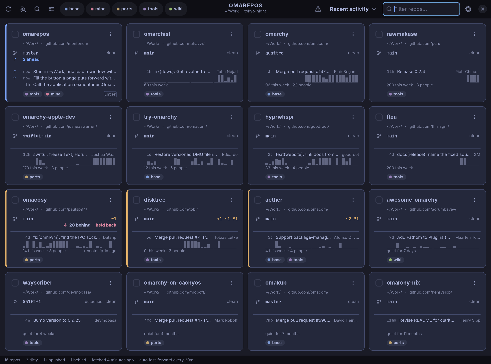
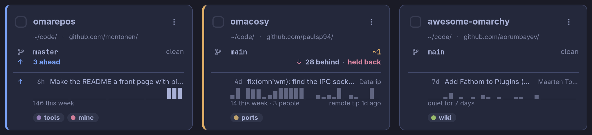
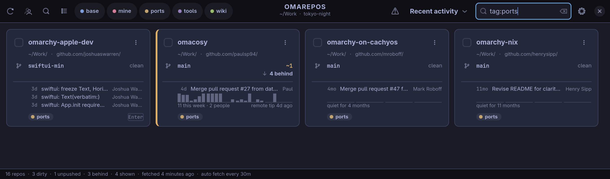
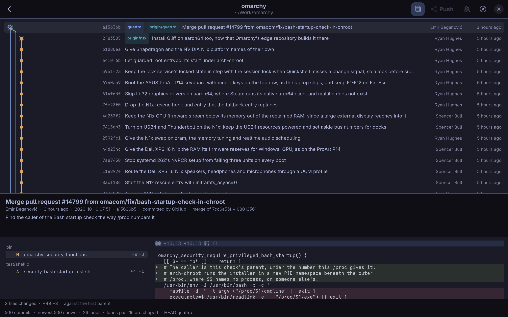
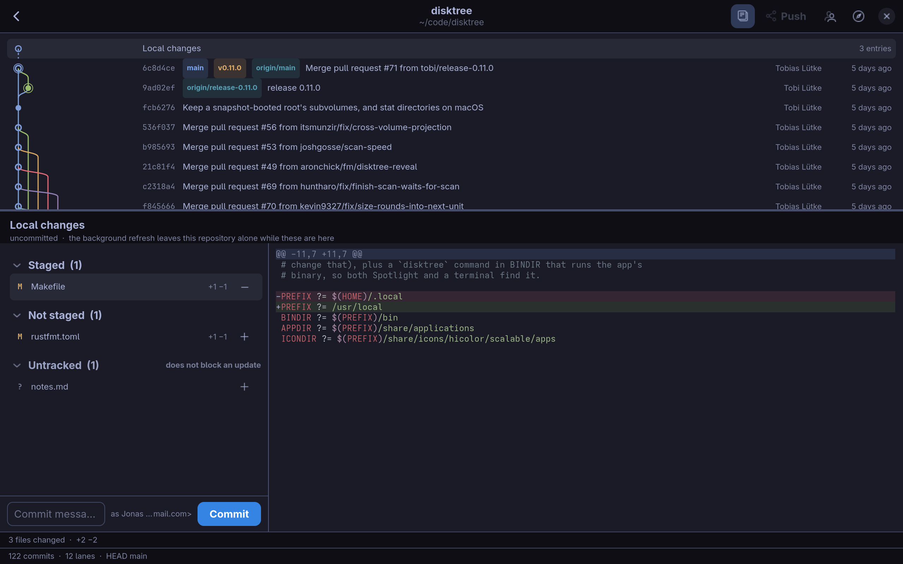
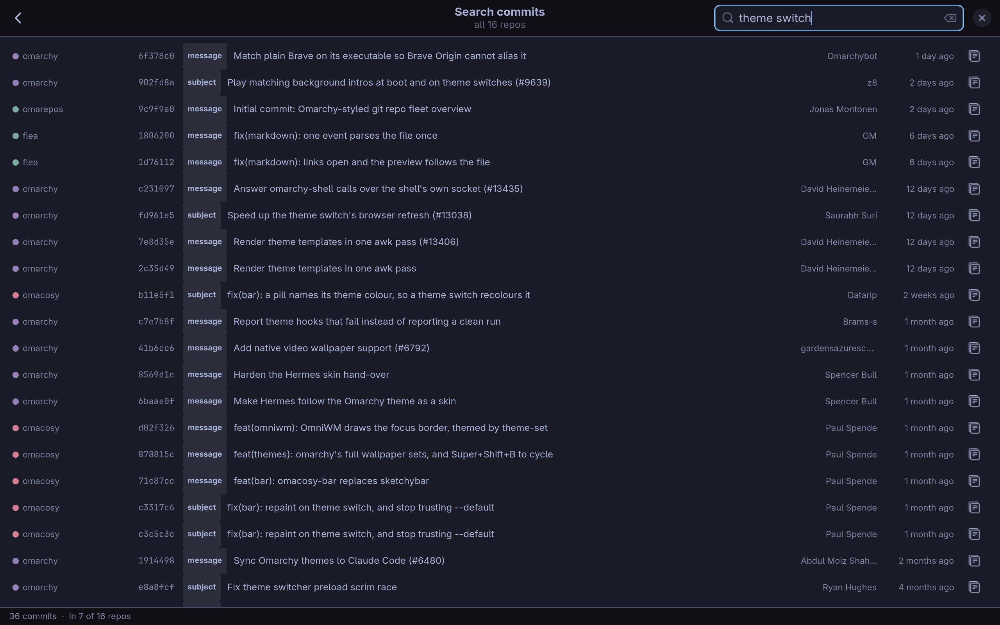
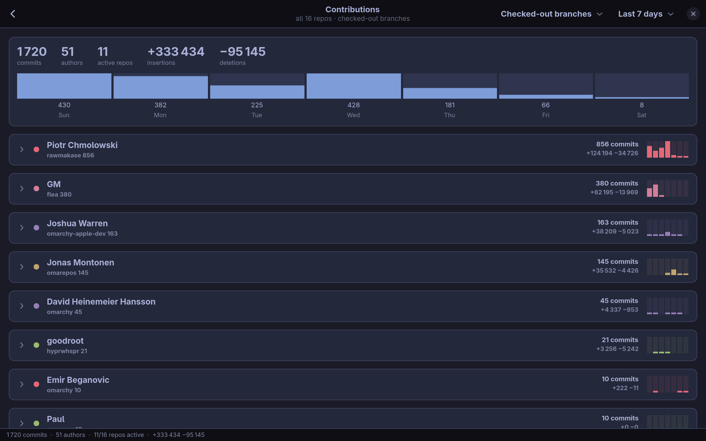
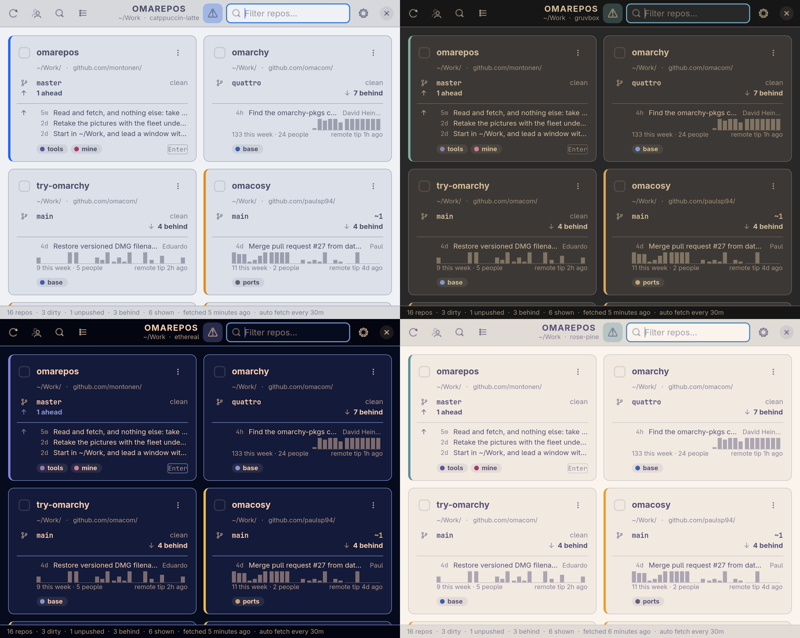

<h1 align="center">
  <br>
  omarepos
</h1>

<p align="center">
  <strong>Every git repository on your machine, on one screen.</strong><br>
  A keyboard-first overview for <a href="https://omarchy.org">Omarchy</a>: what is uncommitted, what is unpushed
  and what is waiting to be pulled, in the theme you are using.
</p>

<p align="center">
  <a href="#a-tour">Tour</a> ·
  <a href="#install">Install</a> ·
  <a href="#keyboard">Keyboard</a> ·
  <a href="#what-it-does-to-a-repository">What it changes</a> ·
  <a href="docs/README.md">Documentation</a>
</p>



omarepos is a GTK4 / libadwaita desktop app. It scans the folders you point it
at and gives every repository it finds a card: where it is, its branch and what
is uncommitted, what exists only here and what is waiting on the remote, the
last commit, and four weeks of activity. **A repository that is clean and level
with its remote is grey, and a coloured edge means there is something to do.**

From a card it is one key to the repository's commit graph, a terminal, your
editor or its page on the web. It reads, and it fetches, when you ask or on a
timer. The one thing it changes is what you ask it to with `p`: it brings a
clean branch that is only behind up to date, one repository at a time. Nothing
moves just because omarepos was open.

<sub>Pictured: this repository and fifteen public Omarchy projects, in a
scratch home directory of their own. [How the pictures are taken](docs/development.md#the-readmes-pictures).</sub>

## A tour

### A card says one thing in each place



Every fact has a place of its own, the same on every card, so where a thing is
says what it is.

| Row | What it says |
| --- | --- |
| Name | The repository |
| Where | The folder it lies in, and the remote it belongs to |
| Branch | The branch, and on the right what is uncommitted: `+1 ~3 ?4` is one staged, three modified, four untracked |
| Sync | `↑ 2 ahead` is what exists only here. `↓ 28 behind` is what is waiting on the remote |
| Commit | The last commit: how old, what it says, and who wrote it when that was not you |
| Lately | Commits a day over the last four weeks, yours solid and other people's fainter |
| Tags | Your own labels, each with a dot in the tag's colour: one of eight, chosen by its name |

Apart from the dot on a tag, colour is kept for what needs you. The left edge
is yellow for uncommitted work, the accent colour for commits that exist
nowhere else, and red for trouble. The card `Enter` would open from the
filter, the first one here, shows the two commits before the last in place of
the four weeks, as does the card the keyboard or the pointer is on.
[Reading a card](docs/cards.md) has the rest.

### Type, then Enter



The filter has the keyboard when the window opens, and the launcher key brings
an open window back with the keyboard there again, unless a commit graph is in
front. Type a few letters of a name, a path, a branch or
a remote; `tag:work` and `lang:rust` narrow by tag and by language; `Enter`
opens the top hit. With up to five tags, each has a button in the header: a
click shows that tag alone, and Ctrl+click adds another. The warning triangle
keeps only the repositories that need something.

### One repository



`Enter` on a card opens its commit graph: every branch, with lanes that fan out
and converge where the merges really were, and the branches, tags and remote
branches named on their commits. The pane below shows what the selected commit
changed, as a tree of files and a highlighted diff, and follows the cursor as
you walk the history. More in [Commit graph](docs/commit-graph.md).

### What is uncommitted



Uncommitted work is the first row of the graph: what is staged, what is not,
what is in conflict and what is untracked, each file with its diff. `Tab` goes
into the list. It is a view, and nothing in it changes anything. To stage,
commit or push, `l` opens a terminal in the repository, in lazygit when it is
installed, and the list is current again when you come back.

### Every history, searched at once



`Ctrl+Shift+F` searches the commits of every repository on the grid, or of the
ones you ticked; on Contributions, of the repositories that page is of, and in
a commit graph, of that one. A commit matches on its subject, or else on the rest of its
message, its author or a sha prefix, and each result says which; the newest
come first. `Enter` opens that repository's graph on that commit. More in
[Searching commits](docs/search.md).

### Who did what



`Ctrl+G` adds up the last 7 days, or as much as the last 12 months, across the
grid or the repositories you ticked: commits and lines per author, and commits per day,
with a mailmap honoured. A row opens to the commits themselves. A second view
counts every branch and not only the checked-out ones, and `r` plays the
same as a race, the authors' or the repositories' bars overtaking one another
day by day. More in
[Contributions](docs/contributions.md).

### Fetching, and pulling when you ask

`f` fetches the repository under the keyboard, and `Ctrl+Shift+R` the whole
grid, or the tags you have limited the refresh to. A timer in the window can
do the same every few minutes; it is off until you give it an interval. A
fetch records what the remote has, so "behind" stays true. It moves no branch
and touches no file. `p` fetches and then fast-forwards the branch, if nothing
in the repository is uncommitted and the branch is only behind; anything else
it leaves for you, and says why. The timer only ever fetches, runs no hooks and
only enters repositories you have already seen. More in
[Fetching](docs/refresh.md).

### Your theme



The window, the cards and the text take their colours from the active Omarchy
theme, used the way Omarchy's own templates use it. `omarchy theme set`
repaints the window as it stands: nothing is cached and nothing needs
restarting. On another desktop it follows the desktop's light or dark, with a
built-in palette for each. The lanes of a graph and the dots on tags and authors keep a fixed
set of eight colours, which a theme's own handful of hues could not keep
apart. More in [Configuration and theme](docs/configuration.md#theme).

## What it does to a repository

A tool pointed at every repository you have should be able to say what it
does to them in a sentence. omarepos reads them, it fetches, and when you ask
it brings one clean branch up to date.

- **Reading never runs `git`, never writes to a repository and never talks to
  a remote.** What is shown is read from disk with libgit2.
- **Fetching** happens on `f`, on `Ctrl+Shift+R`, or on a timer you switch on.
  It goes through the `git` you use yourself, with your credential helpers and
  SSH setup: a repository you cannot fetch by hand is one omarepos does not
  pretend it can fetch either.
- **One update, when you ask.** `p` fast-forwards the branch of the repository
  under the keyboard, if nothing in it is uncommitted and the branch is only
  behind. It is a `git merge --ff-only` with every option spelled out, so your
  settings cannot turn it into a real merge or a stash, and it never
  overwrites an ignored file. The timer never does this.
- **Nothing else.** It does not stage, commit, push, rebase, stash, check out
  or reset, and never makes a merge commit. There is nothing in it that could
  discard an edit or publish one.
- **For everything that changes a repository, it hands over.** `l` opens a
  terminal there, in lazygit when it is installed, and `e` your editor.
- **Tags are omarepos's own.** Nothing is written into your repositories to
  keep them.

More in [What it changes](docs/read-only.md) and [Fetching](docs/refresh.md).

## Install

omarepos is built from source. It needs GTK 4.12 or newer, libadwaita 1.5 or
newer and `git` 2.29 or newer to run; and to build, Rust 1.92 or newer, a C
toolchain, `pkg-config` and the GTK 4 and libadwaita development files. On
Arch and Omarchy that is:

```bash
sudo pacman -S --needed gtk4 libadwaita libgit2 git rust base-devel
```

```bash
git clone https://github.com/montonen/omarepos.git
cd omarepos
cargo install --path .
mkdir -p ~/.local/bin
ln -sf ~/.cargo/bin/omarepos ~/.local/bin/omarepos
install -Dm644 data/se.montonen.Omarepos.desktop ~/.local/share/applications/se.montonen.Omarepos.desktop
install -Dm644 data/se.montonen.Omarepos.svg ~/.local/share/icons/hicolor/scalable/apps/se.montonen.Omarepos.svg
```

The symlink matters on Omarchy: the Hyprland/uwsm session `PATH` carries
`~/.local/bin` but not `~/.cargo/bin`, so without it the desktop entry and any
keybinding both fail to find the binary even though your shell can run it.

### Hyprland keybinding

In `~/.config/hypr/bindings.lua`:

```lua
o.bind("SUPER + SHIFT + R", "Git repos (omarepos)", { launch = "omarepos" })
```

`SUPER+SHIFT` is Omarchy's tier for applications — plain `SUPER` is window
management, `SUPER+CTRL` is system settings, and a second or third app on the
same letter goes to `SUPER+SHIFT+ALT` and `SUPER+SHIFT+CTRL`. `launch` wraps the
command in `uwsm-app`, which puts it in its own systemd scope. Check the key is
free first with `omarchy menu keybindings --print`, and validate with
`hyprctl reload && hyprctl configerrors`.

### Or have your agent install it

If a coding agent works on your machine (Claude Code, or any other that can
run commands there), give it this prompt:

```text
Install omarepos from https://github.com/montonen/omarepos on this machine.

1. Clone it to ~/Work/omarepos, creating ~/Work if it is not there. If
   ~/Work/omarepos exists already, stop and ask me.
2. Read the "Install" section of README.md in the clone and do what it says:
   the packages (ask me before running anything with sudo), then
   `cargo install --path .`, the symlink into ~/.local/bin, the desktop entry
   and the icon.
3. Add the Hyprland keybinding the README gives, on SUPER + SHIFT + R. First
   check that the key is free with `omarchy menu keybindings --print`. If it
   is taken, tell me what has it and propose another key. Back up
   ~/.config/hypr/bindings.lua before editing it, then run
   `hyprctl reload && hyprctl configerrors` and show me what they say.
4. Ask me which folders hold my git repositories. If the answer is anything
   but ~/Work alone, write them as `roots` in ~/.config/omarepos/config.toml,
   after the pattern of config.example.toml in the clone.
5. Check that `~/.local/bin/omarepos --version` runs. Do not start the app,
   and change nothing else on the machine.

Then tell me what you installed and where, and anything you skipped.
```

It is built from source, so give it a few minutes. To update later, ask the
agent to pull in `~/Work/omarepos` and run `cargo install --path .` again. A
window that was open through the update is still the old program, and says so
when you bring it forward.

## Getting started

Start it. With no configuration it looks for repositories under `~/Work`, the
folder Omarchy sets up for work, three levels down. Where it finds none, the
window says which folder it looked in and offers **Choose folders…**, with the
keyboard on it, so `Enter` takes you to Settings.

To look elsewhere, open **Settings** (`Ctrl+,`) and add a folder to scan or a
single repository, or write the same thing in
`~/.config/omarepos/config.toml`:

```toml
roots = [
  "~/Work",
  "~/code",
  { path = "~/clients/acme", nested = true, tag = "acme" },
]
extra_repos = ["~/.config/omarchy"]
```

`omarepos --root <PATH>` is a one-off look at somewhere else, in a window of its
own: the path is not saved, no root tags are applied and no background refresh
runs. [Repositories and tags](docs/repositories.md) covers scan roots, folders
that hold nothing but other clones, and tagging.

## Keyboard

`F1`, or `?` on the grid and in a graph, lists the keys. The ones that carry
most of the work:

| Key | Does |
| --- | --- |
| Type, then `Enter` | Narrow the grid, and open the top hit's commit graph |
| `Down` in the filter | Move into the cards |
| `Enter` on a card | Open its commit graph |
| `l` · `e` · `o` | Open a terminal there (lazygit), your editor, or its page on the web |
| `f` · `p` | Fetch that repository · fetch it and fast-forward, if clean and only behind |
| `Space` on a card | Tick it, to scope the search and contributions |
| `Ctrl+Shift+F` | Search commits across the repositories; on Contributions its own, in a commit graph that one |
| `Ctrl+G` | Contributions |
| `Ctrl+R` · `Ctrl+Shift+R` | Rescan, local only · fetch the whole grid |
| `Tab` in a graph | Into the changed files |
| `Ctrl+,` | Settings |
| `Esc` | Back out, one step at a time |

More of them are in [Usage](docs/usage.md).

## Documentation

| Page | What is in it |
| --- | --- |
| [Usage](docs/usage.md) | Command line, the keys, how the filter matches |
| [Reading a card](docs/cards.md) | Each row of a card, what the colours mean, the four weeks |
| [Repositories and tags](docs/repositories.md) | Scan roots, workspace folders, tags |
| [Commit graph](docs/commit-graph.md) | The graph, what is uncommitted, what a commit changed |
| [Searching commits](docs/search.md) | What is matched, and how far back |
| [Contributions](docs/contributions.md) | What is counted, and the all-branches view |
| [Fetching](docs/refresh.md) | `f`, `p`, the timer, what runs unattended and what does not, and why it runs `git` |
| [Configuration and theme](docs/configuration.md) | `config.toml`, and how the Omarchy theme is used |
| [What it changes](docs/read-only.md) | What is read, what a fetch and `p` change, and what omarepos keeps for itself |
| [Development](docs/development.md) | Building, the tests, the walk, the source layout, the pictures |

## Development

```bash
cargo run --release      # build and run
cargo test               # builds its own scratch repositories; touches nothing else
scripts/walk/walk.sh     # drives a debug build through every page and action
```

A panic inside a GTK callback ends the program, and most of what a window does
cannot be reached by a unit test. So besides the unit tests there is a walk: a
debug build on a hidden workspace, driven over D-Bus through some five hundred
steps on fixture repositories. [Development](docs/development.md) has the
details, and the source layout.

## Status

Early, and in daily use by one person. The grid, the commit graph with its
diff pane, contributions, commit search and fetching are all there. Ahead and
behind are as fresh as the last fetch: with the timer off, that is the last
time you pressed `f` or `Ctrl+Shift+R`.

## License

MIT. See [LICENSE](LICENSE). It carries one font, Press Start 2P, under the SIL
Open Font License 1.1: see [data/fonts/OFL.txt](data/fonts/OFL.txt).
